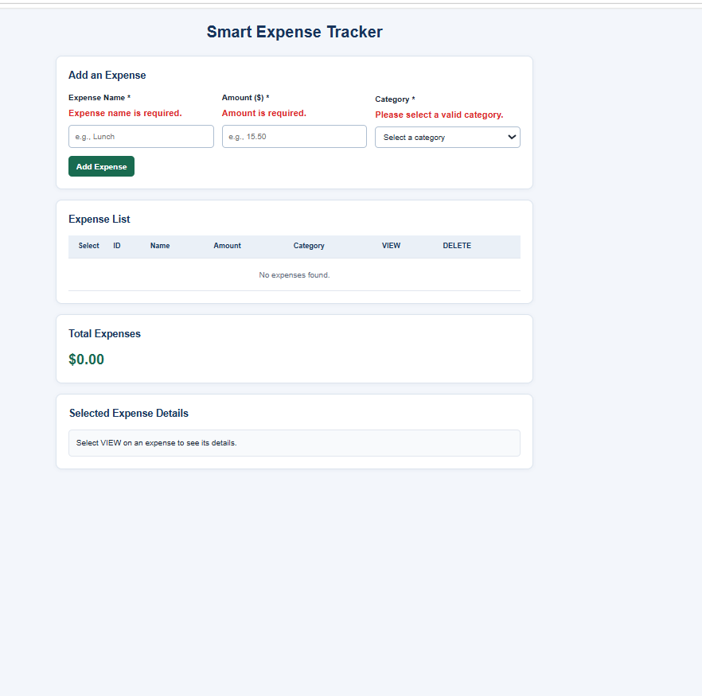
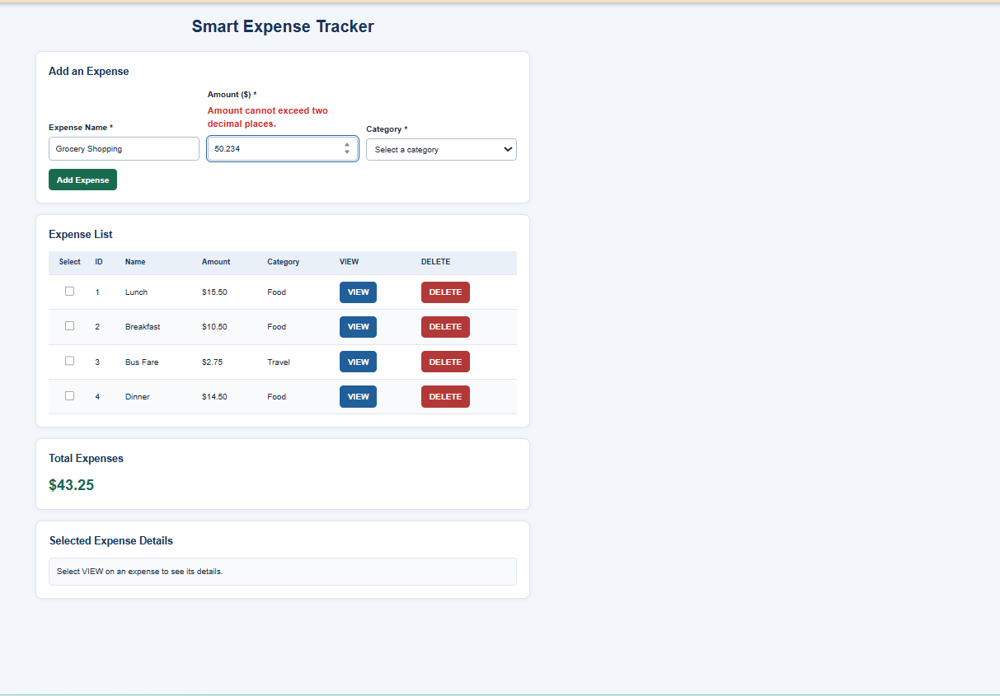
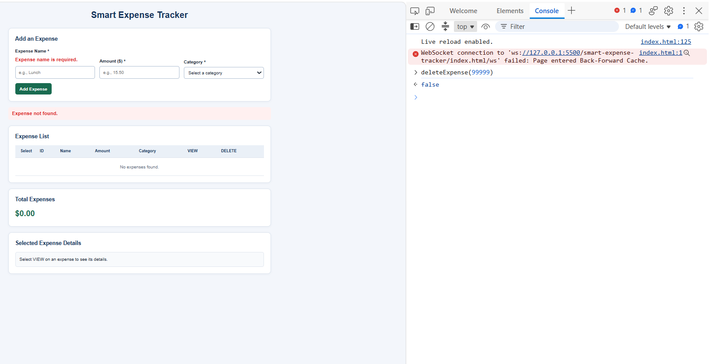
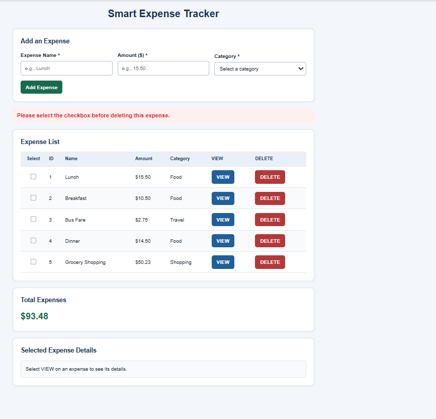

# Smart Expense Tracker

A JavaScript and HTML expense tracker for adding, viewing, and deleting expense records while keeping a running total.

## Features

- **In-memory data:** Store expenses as JSON-compatible JavaScript objects with unique, sequential IDs.
- **Expense list:** Display one table row per record, with a checkbox, **VIEW** button, and **DELETE** button.
- **Checkbox selection:** Select or deselect records without changing their expense data.
- **View details:** Display an expense without modifying it; show a clear error for unknown record IDs.
- **Delete expenses:** Confirm or cancel deletion. Remove only the requested record, and leave data unchanged when deletion is canceled.
- **Running total:** Recalculate the total after adding or deleting an expense.
- **Empty state:** Display a message when no expenses are available.
- **Safe text display:** Use `textContent` for user-entered names to prevent HTML injection.
- **Responsive layout:** Ensure sections display appropriately on desktop and mobile screens using CSS.

## Validation Feature

- Display validation errors immediately above the corresponding input fields within the Add Expense section.
- Validate inputs on the client side without requiring form submission.
- Show errors when a user leaves a required field empty or enters an invalid value.
- Validate text and amount fields during input or when leaving the field, and category when its selection changes.
- Display an asterisk (*) beside required field labels.
- Automatically clear error messages when the input becomes valid.
- Preserve existing validation when the form is submitted.
- Validate the required fields before saving an expense.
- Keep existing valid expenses unchanged when an operation fails.

## Error Handling Feature

- Handle empty expense names.
- Reject invalid, zero, negative, or non-finite amounts.
- Reject invalid categories and handle missing record IDs.
- Keep existing valid expenses unchanged when an operation fails.

## Data Storage

Expenses are stored **in memory** as JavaScript objects. This description does not imply permanent storage across page reloads.

### Smart Expense Tracker — Main Page

*Figure 1. Smart Expense Tracker — Main Page*

### Smart Expense Tracker — Decimal Precision Edge Case

*Figure 2. Smart Expense Tracker — Two-Decimal-Place Limit (Edge Case)*

### Smart Expense Tracker — Wrong ID Edge Case

*Figure 3. Smart Expense Tracker — Wrong ID (Edge Case)*

-Testing an Invalid Expense ID Using the JavaScript Debugger Since the Smart Expense Tracker does not allow users to manually enter an invalid expense ID, this test was performed using the JavaScript Debugger.A breakpoint was set to pause execution, allowing the expense ID to be modified to a nonexistent value.The purpose of this test was to verify that the application displays "Expense not found." without crashing or affecting existing expense records.

### Smart Expense Tracker — Checkbox Validation Before Deletion Test ( Minimal Fix Approach)

*Figure 4. Smart Expense Tracker — Error Message When Deleting Without Selecting a Checkbox*
